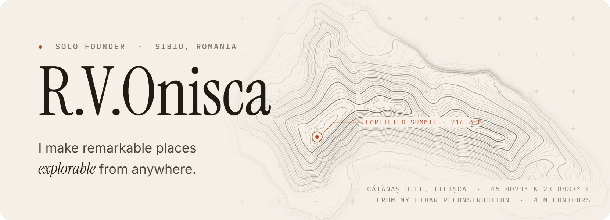
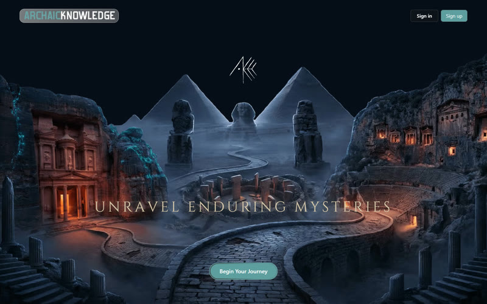
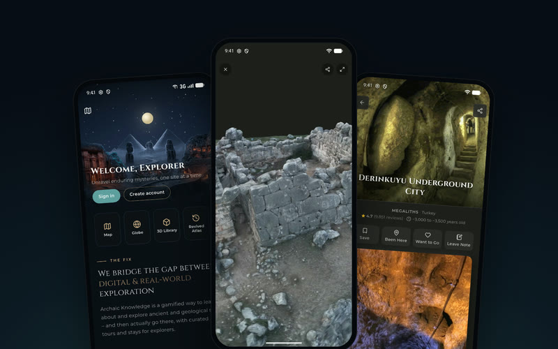
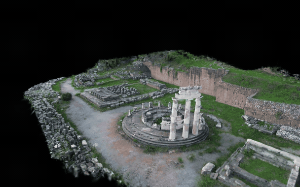
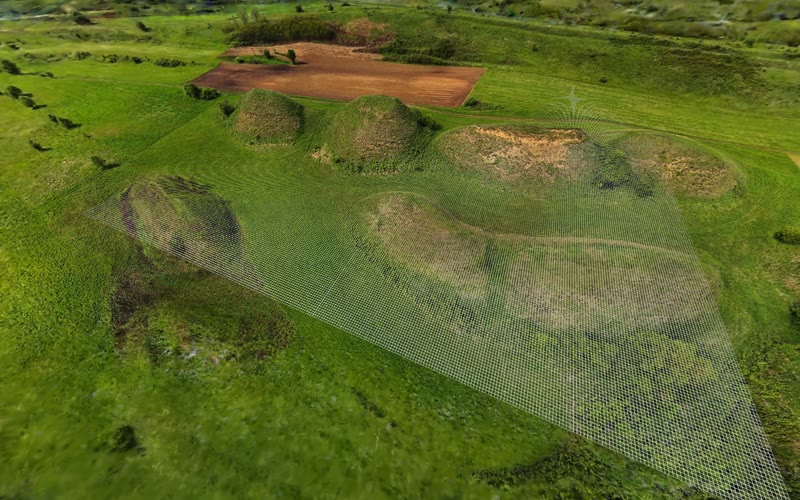
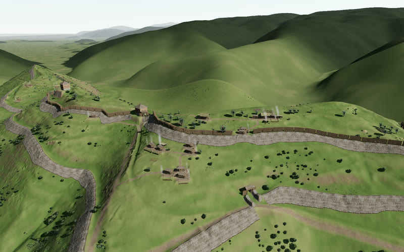
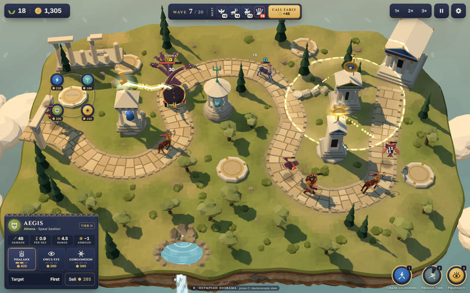

<picture>
  <source media="(max-width: 600px) and (prefers-color-scheme: dark)" srcset="assets/banner-compact-dark.webp">
  <source media="(max-width: 600px)" srcset="assets/banner-compact-light.webp">
  <source media="(prefers-color-scheme: dark)" srcset="assets/banner-dark.webp">
  
</picture>

  <a href="https://www.linkedin.com/in/razvanonisca/">LinkedIn</a> &nbsp;·&nbsp;
  <a href="https://archaic-knowledge-next.vercel.app">Archaic Knowledge</a> &nbsp;·&nbsp;
  <a href="https://neatmedia.co/">neatmedia.co</a>

I capture real places (ruins, ridges, old streets) and turn them into things people can explore on a screen: Gaussian-splat scans, LiDAR reconstructions, maps and small games. Most of it serves **Archaic Knowledge**, my platform for ancient and geological sites. I fly the drone, carry the scanner and write the code.

I also bring seven years of gamification and behavioral design (Octalysis), which is why my products tend to have quests in them.

TypeScript · Three.js / WebGPU · Spark · PlayCanvas · Next.js · Flutter · Supabase · Python · Blender · Cloudflare

### Recognition

**Best Natural Landscape Reconstruction**, Niantic Spatial [#SplatYourWorld](https://nianticspatial.com/blog/splatyourworld-winners), 2026, for my capture of Detunata Goală, a basalt nature reserve in Transylvania.

### Selected work

<table>
  <tr>
    <td width="50%" valign="top">
      
       
      <b>Archaic Knowledge</b> &nbsp;Live · <a href="https://archaic-knowledge-next.vercel.app">visit ↗</a>
       
      A map, globe and 3D library of ancient and geological sites, with quizzes, tours and a restored photo archive. Rebuilt for search and AI answers.
       
      Next.js 16 · Supabase · Mapbox GL · Three.js · Gaussian splats
    </td>
    <td width="50%" valign="top">
      
       
      <b>Archaic Knowledge for Android and iOS</b> &nbsp;Working build
       
      The same world in your pocket: map home screen, globe, quizzes, an eSIM store for travellers and a splat viewer.
       
      Flutter · Riverpod · flutter_map · Supabase
    </td>
  </tr>
</table>

<table>
  <tr>
    <td width="50%" valign="top">
      
       
      <b>Splat Studio</b> &nbsp;Internal tool
       
      Turns 3DGS and LiDAR scans into cinematic video: 31 keyframed effects, 16 camera moves and frame-exact MP4 export, all in the browser.
       
      TypeScript · Spark · Three.js · Mediabunny · Vitest
    </td>
    <td width="50%" valign="top">
      
       
      <b>DigitalTwinz</b> &nbsp;In development
       
      A marketplace for splat scans of real places, for game, VR and heritage teams, plus a drone "Ride" with physics through each scan.
       
      TanStack Start · React 19 · PlayCanvas · Rapier · Supabase · Cloudflare R2
    </td>
  </tr>
</table>

<table>
  <tr>
    <td width="50%" valign="top">
      
       
      <b>Tilișca, Cățănaș hill</b> &nbsp;Working build · public after review
       
      The Dacian fortified settlement, rebuilt from LiDAR and archaeological plans into a site you can walk through in the browser.
       
      Python · Blender · Three.js · Vite · Cloudflare Workers
    </td>
    <td width="50%" valign="top">
      
       
      <b>Mythos Defense</b> &nbsp;Phase 0 · <a href="https://mythos-defense.vercel.app">stress test ↗</a>
       
      A tower-defense game set at real ancient sites, with monsters drawn from the sources. Every model is built in code; two switchable art styles.
       
      React 19 · Three.js · deterministic TypeScript sim · Vitest
    </td>
  </tr>
</table>

Most repositories are private while the products are in development. I'm happy to walk you through the code.

### Also on the bench

- **Merge Splats** (Python): aligns and merges two LiDAR + splat scans of the same place (FFT coarse fit, ICP, elastic warp) and scores the result with its own renderer.
- **Procedural twin** (Python, Blender, Three.js): turns a splat capture into a 6.6 MB relightable scene that runs at about 220 fps.
- **Reel pipeline** (Python, FFmpeg): from an edit list to a finished reel with captions, voice, mix and titles.
- **Nunti** (Next.js): animated wedding invitations with RSVP, about 2.4 KB of own code per invitation.

### Working together

I build photorealistic digital twins for museums, heritage sites and travel teams, and the products around them. The best way to reach me is [LinkedIn](https://www.linkedin.com/in/razvanonisca/).
